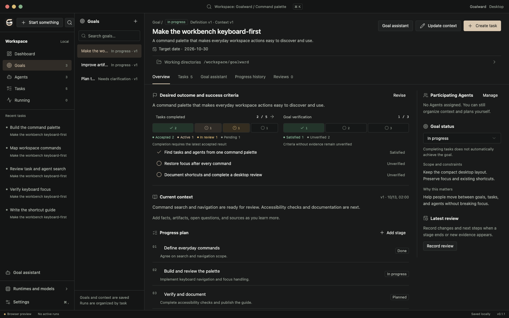
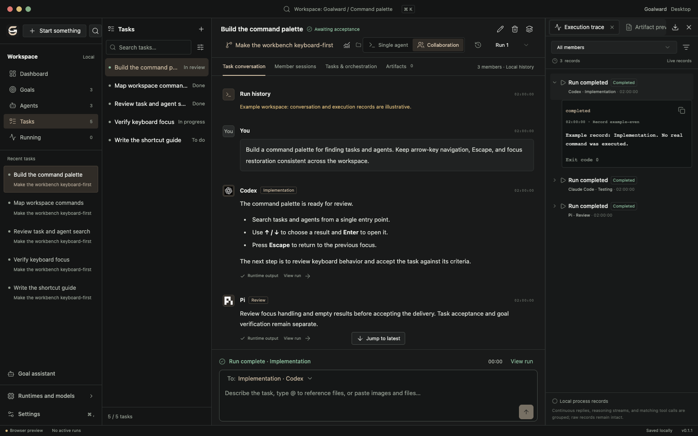
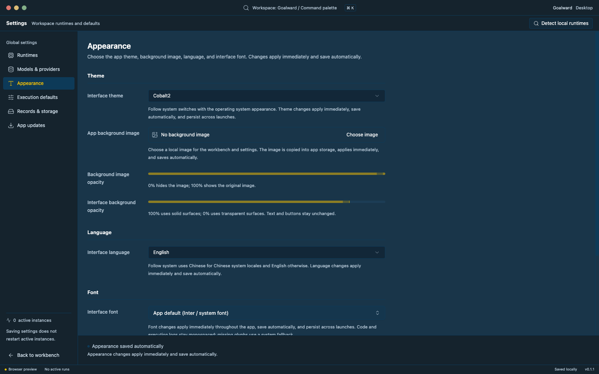

# Goalward

[](https://github.com/Beace/goalward/actions/workflows/ci.yml)
[](https://github.com/Beace/goalward/releases)
[](LICENSE)
[](https://github.com/Beace/goalward/releases)

**[English](README.md) | [中文](README.zh-CN.md)**

> 一款桌面应用，将模糊的想法转化为目标、任务和可验证的成果——由本地编程 Agent 驱动。

## 为什么选择 Goalward？

现代编程 Agent（Codex、Claude Code、Kimi CLI 等）功能强大但相互独立。每个工具都有自己的界面、会话历史和工作区。当你在朝着一个更大的目标努力时——发布一个功能、学习一个框架、重构代码库——你不得不在工具之间来回切换，容易迷失大方向。

Goalward 填补了这个空白：

- **以目标为导向**：从方向出发，而不是命令。Goalward 帮助你明确预期成果、成功标准，并将工作分解为可验证的任务。
- **统一的 Agent 代理**：在一个地方运行多个编程 Agent。原生协议支持意味着流式回复、工具进度和审批请求都按 Agent 原本的方式工作。
- **基于证据的复盘**：每次执行都有记录。产物、对话和结果与任务保持关联。由你决定什么算是完成。
- **本地运行**：Goalward 在本地管理 Agent 进程。没有云端中转——你的代码和凭据留在本机。

## 功能特性

- **目标助手**：描述一个大方向；受限的本地 Agent 帮助明确预期成果、范围和成功标准，然后提议任务。
- **任务管理**：创建、编辑和跟踪与目标关联的任务。设置截止日期、验收标准和依赖关系。
- **多运行时执行**：运行 Codex、Claude Code、Kimi CLI、Pi、DeepSeek Harness 或自定义 CLI 工具。按任务切换 Agent 或组合使用。
- **原生会话**：对话跨轮次持久保存。连接被复用；会话 ID 被保留以便精确恢复。
- **流式输出与审批**：实时观看 Agent 回复。通过原生 UI 处理工具审批、文件变更和权限请求。
- **执行追踪**：每次运行都被记录——输入、输出、工具调用、推理摘要、token 用量和耗时。
- **产物预览**：在检查器面板中直接查看 HTML、Markdown、图片、PDF 和网页。
- **主题与外观**：跟随系统、深色、浅色或 Cobalt2 主题。带可调透明度的背景图片。尊重减少动态效果和透明度偏好。
- **应用内更新**：检查更新、下载签名包、安装，无需离开应用。

## 支持的 Agent

| Agent | 协议 | 流式输出 | 会话延续 | 运行时输入 |
|-------|------|---------|---------|-----------|
| **Codex** | `app-server stdio://` | ✓ | ✓ Thread 恢复 | ✓ Steer |
| **Claude Code** | Agent SDK 双向流 | ✓ | ✓ Session 恢复 | ✓ 后续队列 |
| **Kimi CLI** | ACP | ✓ | ✓ Session 恢复 | 保留草稿 |
| **Pi** | RPC 模式 | ✓ | ✓ Session 恢复 | ✓ Steer |
| **DeepSeek Harness** | CLI | ✓ | — | — |
| **自定义 CLI** | 可配置 | 视情况 | — | — |

Goalward 使用原始的 Agent 可执行文件。你自己安装和认证它们；Goalward 管理进程生命周期和协议集成。

## 截图

**目标概览，包含任务交付进度、成功标准和工作目录：**



**任务工作区，包含对话、执行检查器和产物预览：**



**外观设置，包含主题、背景和语言控制：**



<!-- TODO: 在此处添加演示 GIF，展示目标 → 任务 → 执行流程 -->

*截图展示当前前端界面（1536 × 960），使用示例数据。不展示实时 Agent 执行。*

## 下载

Goalward 运行在 Apple Silicon 和 Intel Mac 上，需要 macOS 13.3 或更高版本。每个下载都是通用应用（arm64 + x86_64）。

<!-- download-link:start -->
**[下载 macOS 安装包 →](https://releases.goalward.dev/v0.6.0/Goalward_0.6.0_macos-universal.dmg)**

全部版本见 [GitHub Releases](https://github.com/Beace/goalward/releases)。
<!-- download-link:end -->

发布版本包含 SHA-256 校验和。应用使用 ad-hoc 签名，未经 Apple 公证；macOS 首次启动时会提示。详见[安装说明](docs/install-macos-trial.zh-CN.txt)了解如何绕过 Gatekeeper。

## 快速开始

1. **下载并安装。** 打开 DMG，将 Goalward.app 拖到"应用程序"，然后启动。如果 macOS 阻止应用，前往"系统设置 → 隐私与安全性"，点击"仍要打开"。

2. **连接 Agent。** 首次启动时，Goalward 检测已安装的运行时。导入检测到的 Agent 或在"设置 → 运行时"中手动配置。确保你的 Agent CLI 已安装并完成认证。

3. **创建目标。** 点击"开始"，描述你想要实现的目标。目标助手帮助明确预期成果和成功标准，然后提议任务。

4. **执行任务。** 打开任务，选择 Agent 和模型，发送指令。使用 `@` 引用文件。观看流式回复，处理审批请求，查看产物。

5. **复盘并继续。** 检查执行追踪和产物。当标准满足时接受任务，或继续迭代。当所有成功标准都有证据时，标记目标为已达成。

## 从源码构建

**前置要求**：macOS 13.3+、Node.js（20.19+、22.12+ 或 24+）、Rust 稳定版、Xcode 命令行工具。

```bash
git clone https://github.com/Beace/goalward.git
cd goalward
npm ci --registry=https://registry.npmjs.org
npm run mac:dev    # 启动带热重载的开发应用
```

**其他命令**：
- `npm run mac:build` — 构建应用包
- `npm run build` — TypeScript + Vite 构建
- `npm test` — 运行前端测试
- `cargo test --manifest-path src-tauri/Cargo.toml` — 运行 Rust 测试

完整的开发设置和 PR 流程请参阅 [CONTRIBUTING.md](CONTRIBUTING.md)。

## Goalward 的不同之处

Goalward 围绕特定的工作流设计：**目标 → 任务 → Agent 执行 → 证据 → 复盘**。

- **目标优先，而非对话优先。** 你从预期成果和成功标准开始，而不是开放式对话。这种结构帮助你保持方向感。
- **原生多 Agent 设计。** 不同的 Agent 擅长不同的任务。Goalward 让你为每个任务选择合适的工具，无需切换应用。
- **显式验证。** 任务接受和目标验证与流程完成是分开的。你审查证据，决定什么算是完成。
- **仅本地执行。** Goalward 是一个在你机器上运行 Agent 的桌面应用。没有托管后端，没有云同步，没有中间人。

## 路线图

计划中的改进（非优先级排序）：

- [ ] **Web 演示**：在 GitHub Pages 上提供带示例数据的浏览器预览
- [ ] **自动复盘**：从执行结果生成总结和下一步建议
- [ ] **并行执行**：使用 git worktree 在同一任务上运行多个 Agent
- [ ] **更多平台**：Windows 和 Linux 构建
- [ ] **插件系统**：自定义运行时适配器和集成

更多未来方向请参阅[产品提案](docs/goal-driven-product-proposal.md)。

## 数据存储

工作区数据存储在本地：
```
~/Library/Application Support/dev.goalward.desktop/
```

Goalward 不会向外部发送数据。你的 Agent 凭据和代码留在本机。

## 贡献

欢迎贡献！请阅读：

- [CONTRIBUTING.md](CONTRIBUTING.md) — 开发设置和 PR 流程
- [CODE_OF_CONDUCT.md](CODE_OF_CONDUCT.md) — 社区准则
- [SECURITY.md](SECURITY.md) — 报告漏洞

## 许可证

[MIT](LICENSE) © 2026 Beace

---

使用 [Tauri 2](https://tauri.app/)、[React](https://react.dev/) 和 [shadcn/ui](https://ui.shadcn.com/) 构建。
